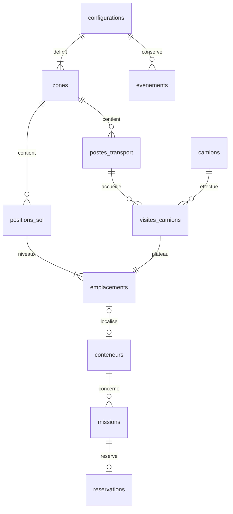

# Conception du stockage et du transport

## Paramètres et hypothèses

| Paramètre | Initial |
|---|---:|
| Espace total X × Y | 1 000 × 500 mm |
| Stockage X × Y | 800 × 500 mm |
| Transport X × Y | 200 × 500 mm |
| Conteneur L × l × h | 100 × 50 × 50 mm |
| Grille | 7 × 7 |
| Niveaux | 3 |
| Emplacements théoriques de stockage | 147 |
| Capacité présente totale | 60 |
| Cabine proposée L × l | 50 × 50 mm |
| Plateau | 100 × 50 mm |
| Nombre proposé de postes camion | 3 |

La cabine est interprétée comme un demi-conteneur **en longueur**, à confirmer. Hauteur dessinée 30 mm, plateau visuel 4 mm : valeurs purement illustratives. La géométrie métier du plateau est actuellement à Z = 0 ; la hauteur réelle de chargement devra être calibrée. Le transport est à gauche, X entre 0 et 200 mm. Le stockage est entre X = 200 et 1 000 mm. Ces choix ne valent pas validation mécanique.

Les coordonnées X/Y stockées désignent le **coin inférieur de l'empreinte** dans le repère, et Z la base du conteneur. Aucune commande de préhenseur ne se déduit directement de ces valeurs. Dans la configuration initiale, les centres de cases sont X = 262,5 + 112,5i et Y = 43,75 + 68,75j mm. Les intervalles, actuellement calculés avec des marges égales, valent 12,5 mm suivant X et 18,75 mm suivant Y.

## Pourquoi une base relationnelle

PostgreSQL local conserve la géométrie, les positions confirmées et l'historique dans des tables liées par des clés étrangères. La simulation serveur en est une cliente ; elle ne conserve pas un fichier JSON comme base principale. `params` et `route` sont des objets JSONB pour les paramètres versionnés et les points d'une animation. L'occupation, les visites et les réservations restent normalisées.

## Modèle

## Dictionnaire des tables

| Table | Champs et rôle |
|---|---|
| configurations | `id` PK ; `params` JSONB avec les 12 paramètres ; `active` ; `mode` simulation/réel ; `created_at`. Une seule version active. |
| zones | `id` PK ; `configuration_id` FK ; `kind` storage/transport ; `x_mm`, `y_mm`, `length_mm`, `width_mm`. Une zone de chaque type par configuration. |
| positions_sol | `id` PK ; `zone_id` FK ; `code` A1…G7 ; `column_index`, `row_index` à partir de zéro ; `x_mm`, `y_mm`. |
| postes_transport | `id` PK ; `zone_id` FK ; `code` Q1… ; `bay_index` ; coordonnées du début du camion ; longueur et largeur réservées au camion. |
| camions | `id` text PK ; longueur cabine, longueur plateau, largeur. Identité conservée indépendamment des visites. |
| visites_camions | `id` PK ; `configuration_id`, `truck_id`, `bay_id` FK ; `arrived_at`, `departed_at` nullable tant que le camion est présent. |
| emplacements | `id` PK ; `configuration_id` FK ; soit `position_id` + `level`, soit `visit_id` ; `z_base_mm`. Exclusivité stockage/plateau vérifiée par CHECK. |
| types_conteneurs | `id` PK ; `configuration_id` FK ; longueur, largeur, hauteur. Géométrie conservée pour chaque version. |
| conteneurs | `id` PK technique ; `code` unique dans la configuration ; `type_id` FK ; `emplacement_id` FK nullable ; `state` ; `confirmed_at`. |
| missions | `id` PK ; `code` ; conteneur, départ et destination FK ; statut, progression, route illustrative, création et fin. |
| reservations | `id` PK ; `mission_id` FK unique ; `emplacement_id` FK ; création et libération. |
| evenements | `id` PK ; configuration FK ; `event_key` unique pour déduplication ; date, type, message et payload. |
| schema_migrations | Numéro de migration et date d'application. |

Les identifiants techniques restent stables dans une configuration. Une réinitialisation de **démonstration** recrée les codes C001… dans une nouvelle version et conserve l'ancienne. Pour du matériel réel, utiliser un identifiant physique global permanent et une opération de reconfiguration avec réconciliation, pas une réinitialisation de démonstration.

## Contraintes implémentées

- Un conteneur localisé par emplacement ; emplacement unique par conteneur.
- Un plateau par visite ; un conteneur par plateau.
- Une seule visite active par camion et par poste.
- Piles supportées sans niveau manquant ; aucun état stocké sur un plateau et réciproquement.
- Une réservation active par destination ; une mission active par conteneur.
- Une seule mission simultanée sur cette maquette, hypothèse d'un seul organe de transport.
- Capacité de la configuration, conteneurs sur camion et en transit compris.
- Blocage du retrait sous une pile, du départ camion et des changements de plan pendant une mission dans la couche métier.
- Sérialisation des écritures applicatives par verrou transactionnel PostgreSQL et validation différée des occupations.

Les commandes passent par l'API. Les contraintes SQL protègent les invariants structurels ; elles ne constituent pas une preuve de la position physique. Les requêtes SQL arbitraires ne sont pas une interface de commande.

## Transactions et historique

La prise confirmée libère la source et passe le conteneur en transit. Le dépôt l'associe à la destination, termine la mission et libère la réservation dans une même transaction. Une mission est suspendue au redémarrage du serveur. La simulation exige une reprise explicite. Le redémarrage réel nécessitera une réconciliation matérielle.

Un départ camion conserve la visite et le conteneur sorti dans les tables. L'écran n'affiche que les conteneurs actuellement présents. Les événements sont conservés en base ; l'écran affiche les derniers événements. La lecture de l'état utilise une transaction cohérente.

## Extensions prévues

Caméras, versions de calibration, observations horodatées, suivi et fusion d'obstacles, trajets optimisés et alertes seront ajoutés par migrations. Ne pas enregistrer chaque image dans une ligne d'occupation. Les observations, le trajet prévu et les positions confirmées sont trois catégories distinctes.
