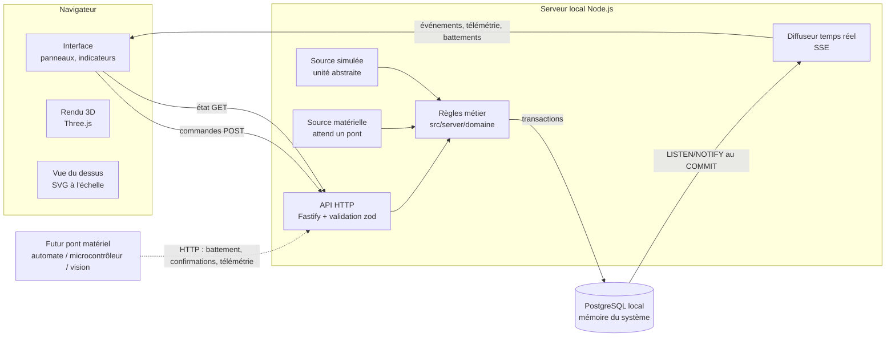

# Architecture

## Couches

| Couche | Emplacement | Responsabilité |
|---|---|---|
| Rendu de la scène | `src/client/scene3d.ts`, `src/client/vue-dessus.ts` | dessiner l'état reçu ; aucune règle métier |
| Interface | `src/client/main.ts`, `src/client/panneaux/` | sélection, commandes, affichage des refus |
| API | `src/server/app.ts` | validation des entrées, traduction des erreurs en messages français |
| Règles métier | `src/server/domaine/` | missions, camions, plans, règles d'accessibilité |
| Base | `db/migrations/` | schéma, contraintes, déclencheurs : dernier rempart de cohérence |
| Source simulée | `src/server/sources/simulation.ts` | exécute les missions, produit des confirmations **simulées** |
| Source physique | `src/server/sources/materiel.ts` | état du pont matériel ; confirmations **physiques** via l'API |
| Géométrie | `src/shared/geometrie.ts` | calcul pur des zones, grille, postes à partir des paramètres |

Les deux sources appellent **les mêmes fonctions métier** (`confirmer`, `interrompre`, …) :
passer de la simulation au matériel ne change ni la base, ni l'API, ni l'interface.

## Repère et unités

- Unité : **millimètre** partout (colonnes `_mm`).
- Origine **O** : coin de l'espace de travail en (X min, Y min), sur le plan de pose des conteneurs.
- **X** suivant la longueur (1 000 mm), **Y** suivant la largeur (500 mm), **Z** vertical vers le haut.
- (x, y) d'une position ou d'un emplacement : **centre** de l'empreinte au sol.
- z d'un emplacement : **base** (face inférieure) du conteneur posé à ce niveau : `z = (niveau − 1) × hauteur`.
- Convention modifiable : zone transport à l'extrémité **X max** (`transport_cote`), cabine des camions côté X max.
- La vue 3D utilise le même repère (Z vers le haut) ; la vue du dessus affiche O en bas à gauche.

## Flux d'une mission

1. **Demande** (`POST /api/missions`) : règles vérifiées, mission `EN_ATTENTE`, source et destination **réservées**.
   La position enregistrée du conteneur ne change pas.
2. **Démarrage** par la source d'événements (`EN_COURS`), calcul d'un trajet de simulation versionné (`trajet`, `point_trajet`).
3. **Prise confirmée** : le conteneur passe `EN_TRANSFERT` (il n'occupe plus aucun emplacement).
4. **Dépôt confirmé** : le conteneur est `EN_PLACE` à destination ; mission `TERMINEE` ; réservations libérées.

Suspension (`SUSPENDUE`) : arrêt planifié, état cohérent, reprise possible.
Interruption (`INTERROMPUE`) : incident ; si la prise était confirmée, le conteneur devient `INCERTAINE`
(dernière position connue conservée), la file d'exécution s'arrête et une alerte est ouverte. L'opérateur reprend la mission
(en confirmant que le conteneur est toujours tenu) ou **déclare** la position constatée.
Annulation après la prise : le conteneur n'est **jamais** remis automatiquement à son point de départ.

## Cohérence et concurrence

- Chaque commande s'exécute dans **une transaction** précédée d'un **verrou consultatif global**
  (`pg_advisory_xact_lock`) : les demandes simultanées sont traitées l'une après l'autre (adapté à un seul portique).
- Index uniques partiels : une réservation active par emplacement, une mission active par conteneur, un camion par poste…
  Ils protègent aussi contre un autre processus qui écrirait directement en base.
- Déclencheurs **différés** (vérifiés au COMMIT) : empilement sans support, plan actif, plateau d'un camion présent, capacité,
  départ d'un camion engagé.
- Confirmations **idempotentes** : unicité `(source, cle_idempotence)` ; une confirmation reçue deux fois n'est appliquée qu'une fois,
  un rejet est tracé.

## Temps réel

- **SSE** (`GET /api/flux`) : adapté à une API locale (HTTP simple, reconnexion automatique du navigateur).
  Les commandes restent des requêtes HTTP classiques.
- Les événements sont écrits dans `evenement` (identifiant croissant stable, `uuid`, horodatage serveur et horodatage source)
  puis notifiés par PostgreSQL **après COMMIT** : un événement diffusé est toujours un événement enregistré.
- Reprise : le navigateur renvoie `Last-Event-ID` ; le serveur rejoue les événements manqués (ou demande un rechargement complet).
  Après toute reconnexion, l'interface recharge l'état complet (`GET /api/etat`).
- Battement toutes les 5 s (état de PostgreSQL et de la source). Sans message pendant 12 s, l'interface affiche
  « données potentiellement anciennes » et désactive les commandes.
- Télémétrie (position de l'unité) : transitoire, non stockée, pour l'animation.

## Pourquoi ces technologies

| Choix | Raison |
|---|---|
| Node.js + TypeScript exécuté nativement | un seul langage client/serveur, typage, aucune étape de compilation côté serveur |
| Fastify | API HTTP robuste, simple à lire |
| `pg` (node-postgres) | pilote PostgreSQL de référence, LISTEN/NOTIFY |
| zod | validation explicite des requêtes et des paramètres |
| Three.js | 3D WebGL la plus documentée, caméra orthographique (échelle conservée) |
| SVG | vue du dessus nette, cliquable, en millimètres |
| Vite | construction de l'interface, rechargement à chaud |
| node:test + playwright-core | tests sans framework lourd ; navigateur réel déjà installé (Edge/Chrome) |
