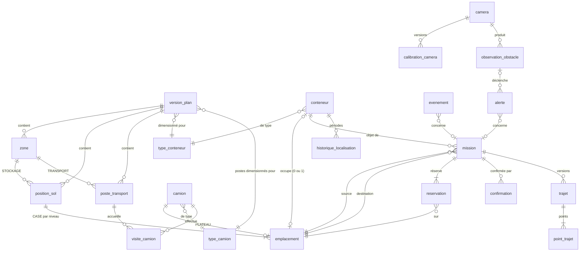

# Modèle relationnel et dictionnaire des données

Source de vérité : `db/migrations/001_schema_initial.sql`, `002_regles_integrite.sql`, `003_extensions_futures.sql`.
Unités : millimètres (`_mm`), horodatages `timestamptz`. Identifiants : entiers générés (`GENERATED ALWAYS AS IDENTITY`), stables.

## Vue d'ensemble

## Choix de modélisation (justifications)

**Table commune `emplacement`.** Tout lieu pouvant porter *un* conteneur est une ligne de `emplacement` :
- `CASE` = position au sol × niveau, appartenant à une version de plan ;
- `PLATEAU` = plateau d'un camion (1 par camion), utilisable seulement pendant une visite présente.

Avantages : le conteneur (`conteneur.emplacement_id UNIQUE`), les missions (source/destination) et les réservations
pointent vers **une seule** table, avec **une** contrainte d'unicité. Un conteneur ne peut donc pas être à la fois
en stockage et sur un camion (une seule colonne de localisation), et un emplacement ne porte jamais deux conteneurs.
La contrainte `emplacement_forme` impose les colonnes pertinentes selon le type (pas de ligne ambiguë).

**État + localisation cohérents.** `conteneur_etat_coherent` :

| `etat` | `emplacement_id` | `mission_transfert_id` | sens |
|---|---|---|---|
| `EN_PLACE` | renseigné | vide | dans une case à un niveau, ou sur le plateau d'un camion présent |
| `EN_TRANSFERT` | vide | renseigné (unique) | pris par l'unité de manutention pendant une mission |
| `INCERTAINE` | vide | vide | position à confirmer ; `derniere_x/y/z_mm` + `motif_incertitude` |
| `SORTI` | vide | vide | hors de la zone (parti sur un camion, ou déclaré sorti) |

**Versions de plan immuables.** Les paramètres (dimensions, grille, marges, capacité, camions, postes) forment une
`version_plan`. Les positions, emplacements et postes sont **générés** à partir des paramètres et **matérialisés** :
ils pourront plus tard être recalés sur des mesures réelles. Une version activée devient immuable (déclencheurs) ;
un changement de configuration crée une nouvelle version. À l'activation, un conteneur n'est rattaché au nouveau plan
que si son lieu physique est identique ; sinon l'activation est refusée, ou forcée en le passant `INCERTAINE` :
**aucun déplacement fictif**.

**Camion ≠ poste ≠ visite.** `camion` est stable (code), `poste_transport` appartient à un plan, `visite_camion` est un
passage (arrivée → départ) ou une tentative refusée (`REFUSEE`, sans poste, avec motif).

**Historique.** `evenement` (journal en ajout seul) + `historique_localisation` (périodes, tenue par déclencheur,
une seule période ouverte par conteneur) + `confirmation` (ajout seul). On peut répondre à « où était tel conteneur à telle heure ? ».

## Dictionnaire des données

### Configuration et géométrie

**`version_plan`** — une configuration complète de la maquette.
| Colonne | Type | Description / contrainte |
|---|---|---|
| id | integer PK | |
| numero | integer UNIQUE | numéro lisible (1, 2, …) |
| libelle | text | |
| statut | text | `BROUILLON` → `ACTIVE` → `ARCHIVEE` ; **une seule ACTIVE** (index unique partiel) |
| espace_longueur_x_mm, espace_largeur_y_mm | numeric | > 0 |
| transport_longueur_x_mm | numeric | > 0, < longueur de l'espace |
| transport_cote | text | `X_MIN` / `X_MAX` (convention) |
| nb_positions_x, nb_positions_y, nb_niveaux_max | smallint | > 0 |
| marge_x_mm, espacement_x_mm, marge_y_mm, espacement_y_mm | numeric | valeurs **effectives** (calculées si « automatique ») |
| nb_conteneurs_max | integer | ≥ 0 |
| perimetre_capacite | text | `ZONE` (toute la maquette) / `STOCKAGE` |
| type_conteneur_id, type_camion_id | FK | dimensions utilisées pour le plan |
| parametres | jsonb | saisie complète (traçabilité) |
| cree_le, active_le, archivee_le | timestamptz | cohérents avec le statut (CHECK) |

**`type_conteneur`** (`longueur_mm`, `largeur_mm`, `hauteur_mm`, unique par dimensions) et
**`type_camion`** (`cabine_*_mm`, `plateau_*_mm`, `hauteurs_illustratives`) : lignes réutilisées, jamais modifiées.

**`zone`** — `STOCKAGE` ou `TRANSPORT` d'une version : `x_min_mm … y_max_mm` (CHECK max > min), unique par (version, code).

**`position_sol`** — une pile possible.
| Colonne | Description |
|---|---|
| version_plan_id, zone_id | FK composite garantissant que la zone appartient à la même version |
| ix, iy | indices 1…n suivant X et Y ; unique par version |
| code | `A1`… (lettre = colonne X, chiffre = rangée Y) ; unique par version |
| centre_x_mm, centre_y_mm | centre de l'empreinte |
| statut, motif_blocage | `DISPONIBLE` / `BLOQUEE` (état opérationnel : « vide ≠ utilisable ») |

**`poste_transport`** — place de stationnement : `code` (`P1`…), centre, empreinte `longueur_x_mm × largeur_y_mm`,
`cote_cabine`, `statut` `DISPONIBLE`/`HORS_SERVICE` + motif.

**`emplacement`** — lieu pouvant porter un conteneur.
| Colonne | CASE | PLATEAU |
|---|---|---|
| type | `CASE` | `PLATEAU` |
| code | `A1-N2` (unique par version) | `PLATEAU-<camion>` (unique) |
| version_plan_id, position_sol_id, niveau, z_base_mm | renseignés | vides |
| camion_id | vide | renseigné (unique : un plateau par camion) |
Contraintes : `emplacement_forme`, UNIQUE (position_sol_id, niveau).

### Conteneurs, camions, missions

**`conteneur`** — `code` unique, `type_conteneur_id`, `etat`, `emplacement_id` (UNIQUE), `mission_transfert_id` (UNIQUE),
`derniere_x/y/z_mm`, `motif_incertitude`, `demo`, `cree_le`, `modifie_le`, `version_ligne` (incrémentée à chaque modification).

**`camion`** — `code` unique, `type_camion_id`, `demo`.

**`visite_camion`**
| Colonne | Description |
|---|---|
| camion_id, poste_id, version_plan_id | poste vide si refusée |
| statut | `PRESENTE` / `PARTIE` / `REFUSEE` |
| arrivee_le, depart_le | `depart_le` ssi `PARTIE` |
| code_conteneur_annonce, conteneur_arrivee_id, conteneur_depart_id | chargement à l'arrivée et au départ |
| plateau_x/y/z_mm | position du plateau pendant la visite |
| motif_refus | ssi `REFUSEE` |
Index uniques partiels : un camion `PRESENTE` par poste ; une visite `PRESENTE` par camion.

**`unite_manutention`** — unité **abstraite** (mécanisme non choisi) : dernière position connue `x/y/z_mm`, `position_le`, `source_position`.

**`mission`**
| Colonne | Description |
|---|---|
| conteneur_id, source_emplacement_id, destination_emplacement_id | source ≠ destination |
| type | `STOCKAGE_VERS_STOCKAGE`, `CAMION_VERS_STOCKAGE`, `STOCKAGE_VERS_CAMION`, `CAMION_VERS_CAMION` |
| statut | `EN_ATTENTE`, `EN_COURS`, `SUSPENDUE`, `INTERROMPUE`, `TERMINEE`, `ANNULEE` |
| origine, executant | `OPERATEUR`/`SYSTEME` ; `SIMULATION`/`MATERIEL` |
| demandee_le, demarree_le, prise_confirmee_le, depot_confirme_le, interrompue_le, terminee_le | chronologie (CHECK d'ordre) |
| motif_fin | raison d'interruption ou d'annulation |
| version_plan_id, unite_manutention_id | |
Index uniques partiels : une mission non terminée par conteneur ; une mission `EN_COURS`/`SUSPENDUE` par unité.

**`reservation`** — `mission_id`, `emplacement_id`, `role` (`SOURCE`/`DESTINATION`, unique par mission),
`statut` `ACTIVE`/`LIBEREE`, dates, motif. **Une seule réservation ACTIVE par emplacement** (toutes missions confondues).
Un déclencheur vérifie que l'emplacement réservé est bien la source/destination de la mission.

**`confirmation`** — `source` (`SIMULATION`/`MATERIEL`/`OPERATEUR`), `cle_idempotence`, `type` (`PRISE`/`DEPOT`/`POSITION_DECLAREE`),
`mission_id`, `conteneur_id`, `horodatage_source`, `recue_le`, `resultat` (`APPLIQUEE`/`REJETEE`) + `motif_rejet`.
UNIQUE (source, cle_idempotence). Ajout seul.

### Historique et alertes

**`evenement`** — journal en ajout seul : `id` croissant (identifiant SSE), `uuid`, `type`, `horodatage` (serveur),
`horodatage_source`, `source`, `gravite`, `message` (français), références (`conteneur_id`, `mission_id`, `visite_id`,
`camion_id`, `emplacement_id`, `confirmation_id`, `version_plan_id`), `donnees` jsonb.
Notification `pg_notify('portique_evenements')` à chaque insertion.

**`historique_localisation`** — périodes `[debut, fin)` par conteneur : `etat`, `emplacement_id`, `mission_id`, coordonnées
au moment de la période ; une seule période ouverte par conteneur.

**`alerte`** — `type`, `gravite` (`INFO`/`AVERTISSEMENT`/`CRITIQUE`), `message`, `statut` (`OUVERTE`/`ACQUITTEE`/`RESOLUE`),
références mission / conteneur / observation.

### Extensions futures (structures prêtes)

| Table | Contenu |
|---|---|
| `camera` | code, modèle, résolution, active |
| `calibration_camera` | version par caméra, matrice intrinsèque, distorsion, rotation, translation (mm, repère maquette), erreur de reprojection ; une seule `VALIDE` par caméra |
| `observation_obstacle` | source (`VISION`/`MANUELLE`/`SIMULATION`), caméra, calibration, `classe` (`HUMAIN`/`OBJET`/`INCONNU`), confiance, boîte englobante 3D (mm), identifiant de suivi, modèle IA |
| `trajet` | version par mission, algorithme, `optimise`, critère, statut, motif de calcul, observation déclenchante, trajet remplacé, longueur, durée |
| `point_trajet` | points ordonnés (x, y, z, type `DEPART`/`PASSAGE`/`PRISE`/`DEPOT`/`FIN`) |

`trajet` et `point_trajet` sont déjà alimentés par la simulation (`SIMULATION_LINEAIRE`, `optimise = false`) ;
une reprise après interruption crée une nouvelle version.

## Règles et où elles sont garanties

| Règle | Base de données | Service métier (explication) |
|---|---|---|
| Un conteneur par emplacement | `UNIQUE conteneur.emplacement_id` | `OCCUPE` |
| Un conteneur par plateau | idem + `UNIQUE emplacement.camion_id` | `OCCUPE` |
| Un camion par poste occupé | index partiel `visite_un_camion_par_poste` | refus `POSTE_OCCUPE` / `AUCUN_POSTE_DISPONIBLE` tracé |
| Pas d'empilement sans support | déclencheur différé `pile_continue` (PT001) | `SANS_SUPPORT`, `SUPPORT_EN_MISSION` |
| Retrait direct au sommet | même déclencheur (ancienne pile) | `PAS_AU_SOMMET` (liste des conteneurs à déplacer) |
| Destination réservée une seule fois | index partiel `reservation_une_active_par_emplacement` | `RESERVE` |
| Un conteneur dans une seule mission | index partiel `mission_une_active_par_conteneur` | `CONTENEUR_DEJA_EN_MISSION` |
| Départ interdit pendant un transfert | déclencheur différé (PT005) | `CAMION_EN_TRANSFERT` |
| Capacité | déclencheur différé (PT004) | refus `CAPACITE` à l'arrivée |
| Destination vide mais inutilisable | `position_sol.statut`, `poste_transport.statut` | `POSITION_BLOQUEE`, `POSTE_HORS_SERVICE` |
| Plan actif seulement | déclencheur (PT002) | — |
| Historique non modifiable | déclencheurs ajout seul (PT007), versions immuables (PT006) | — |
